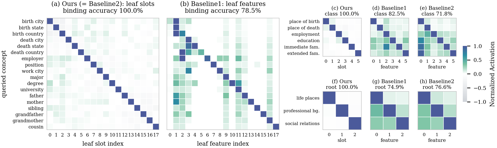

<div align="center">

# TaxoSAE: Rethinking Sparse Autoencoders through Taxonomic Logic

<!-- Badges: add the paper / arXiv links once public -->
[](#-citation)
[](https://www.python.org/)
[](https://pytorch.org/)

_Reading and steering a **whole taxonomy** in a language model: one dedicated SAE slot for every leaf, class and root concept._

<a href="#-overview">Overview</a> •
<a href="#-key-findings">Key Findings</a> •
<a href="#%EF%B8%8F-installation">Installation</a> •
<a href="#-quick-start">Quick Start</a> •
<a href="#-repository-structure">Structure</a> •
<a href="#-evaluation">Evaluation</a> •
<a href="#-citation">Citation</a>

</div>

<p align="center">
  
</p>
<p align="center"><sub><b>Slot binding, relation world (layer 6).</b> Each of our slots responds to its own concept at every level of the taxonomy: 18 relations, 6 relation types and 3 domains. A single feature of an unsupervised SAE (DiffMean Unsup. SAE) also responds to related relations, and the features found for types and domains respond to other types and domains as well.</sub></p>

---

## 📌 Overview

**TaxoSAE** extends concept-aligned SAEs from a flat set of concepts to a **taxonomy**: leaf → class → root.

- **Three stacked levels.** The model has three SAE levels, one per tier of the taxonomy. Each level reconstructs the previous one. Every node gets its own **concept slot** at its level, next to a bank of free slots and the property slots.
- **Hierarchical supervision.** Only leaf labels are needed. The class and root targets are *derived* from the leaf predictions through the taxonomy, so the upper slots learn the abstract concept rather than a list of children.
- **Training recipe.** 10,000 free slots per level. A concept/free orthogonality loss (summed squared cross-covariance, λ = 1e-2). The "pre-train, then post-train" curriculum: 100 epochs of reconstruction + sparsity, then 500 epochs with every loss.

**What's in this repo**
- 🧬 **`relation18/`**: synthetic biographies. 18 relations → 6 relation types → 3 domains. GPT-2 layer 6, slot edits at the last token.
- 🐾 **`animal18/`**: animals. 18 animals → 6 classes → 2 roots (vertebrate / invertebrate). GPT-2 layer 9, slot edits at every prompt position (error-preserving: each position gets h + decode(z_edit) − decode(z), so the SAE reconstruction error is kept).
- 🛠️ **End-to-end scripts.** Activation collection, SAE training, three baselines, all tests, the paper tables and the figures.
- 📦 **Shipped artifacts.** The fine-tuned GPT-2, the activations, and every trained checkpoint, so the tables reproduce without retraining.

**Baselines**, all with one feature per node (k = 1):

| baseline (paper name) | name in code | levels | how a node gets its feature |
|---|---|---|---|
| DiffMean Unsup. SAE | `baseline1` | three unsupervised ReLU SAEs | the most *differential* feature (largest gap to the strongest other node) |
| Hybrid SAE | `baseline2` | **our** frozen leaf module + unsupervised class / root SAEs | same as DiffMean |
| Random Unsup. SAE | `baseline0` | DiffMean's dictionary | a fixed, **unselected** feature (lower bound; mean of four assignments) |

## 🔑 Key Findings

Relation world (Bio), GPT-2 layer 6, against DiffMean Unsup. SAE (k = 1), as in Table 1 of the paper; full results for both worlds are in `*/results/tables.md`.

| Finding | TaxoSAE | DiffMean Unsup. SAE |
| --- | --- | --- |
| **Concept readout**: leaf / class / root read from leaf questions (%) | **100.0 / 100.0 / 100.0** | 77.9 / 82.1 / 75.4 |
| **Abstract concepts**: class read from *unseen* class questions (%) | **69.8** | 61.4 |
| **Class-level steering**: class swap, Target-only coverage, cross-root (%) | **41.8** | 12.2 |
| **Selectivity**: other classes kept when one class slot is ablated | **1.00** | 0.60 |
| **Concentration**: Top1C of a class concept's activation mass (%) | **91.9** | 3.5 |
| **Unseen concepts** (Animal): class read for animals never bound (%) | **63.9** | 26.0 |
| **Lower bound**: Random Unsup. SAE class swap / readout (%) | — | 0.0 / ≤ 6.7 |

## ⚙️ Installation

```bash
conda create -n hsae python=3.10 -y && conda activate hsae
pip install torch==2.10.0 --index-url https://download.pytorch.org/whl/cu128   # pick the wheel for your CUDA
pip install -r requirements.txt
python -c "import torch, transformers; print(torch.__version__, torch.cuda.is_available(), transformers.__version__)"
```

**Requirements:**

- Linux and an NVIDIA GPU. The paper runs used H100 80 GB; ≥ 24 GB is enough for the tests.
- `nvidia-smi` on the PATH: the job scheduler places jobs by free GPU memory.
- `run.sh` uses the `python` on your PATH; set `PY=/path/to/python` to override.

## 🚀 Quick Start

Each world directory is self-contained, with its own data, checkpoints, `run.sh` and README. Commands run from inside it.

> **Note:** the git repository does not track the large artifacts: `models/` (fine-tuned GPT-2 `base_lm` and all SAE
> checkpoints) and the cached activations `data/01_activations/*.pkl`. Put the fine-tuned LM in `<world>/models/base_lm`
> (relation18: `models/base_lm/final`); `run.sh act` then rebuilds the activations and `run.sh all` everything else.

### Reproduce the tables (shipped checkpoints, ~1–2 h per world on one H100)

```bash
cd relation18                     # or: cd animal18
GPUS=0 bash run.sh baselines      # builds only what is missing
GPUS=0 bash run.sh test           # Tests A–F for every system      -> results/{A..F}
bash run.sh tables                # Tables A–F, paper layout        -> results/tables.md
GPUS=0 bash run.sh figures        # paper figures                   -> figures/{pdf,png}
```

### Retrain everything from scratch

```bash
cd relation18
rm -rf models/stage1_L6 models/hier_sae_L6 models/baseline{1,2}_L6 models/baseline0 results figures/readout_raw
GPUS=0,1 bash run.sh all          # act -> train -> baselines -> test
bash run.sh tables && GPUS=0 bash run.sh figures
```

For `animal18`, use `L9` in place of `L6`. Delete `data/01_activations/*.pkl` to also recompute the activations.

| stage | what it does | time (one H100) |
|---|---|---|
| `act` | activations of the training / held-out questions | minutes |
| `train` | stage 1 (100 ep) → stage 2 (500 ep) | ~2–3 h relation, ~4–5 h animal |
| `baselines` | DiffMean (`baseline1`), Hybrid (`baseline2`, on our leaf module), Random (`baseline0`) | ~1–2 h each |
| `test` | Tests A–F, parallel over `$GPUS` | ~1–2 h |

Every stage skips outputs that already exist, so an interrupted run resumes when you run the same command again. Logs are in `logs/<job>.log`.

## 📁 Repository Structure

```
TaxoSAE/
├── README.md, requirements.txt
├── relation18/                     # relation world (layer 6)
│   ├── run.sh                      #   act | train | baselines | test | tables | figures | all
│   ├── scripts/
│   │   ├── pipeline.py             #   every stage, with the system's hyper-parameters
│   │   ├── make_tables.py          #   Tables A–F (conventions documented at the top)
│   │   ├── 03_collect_activations.py, 04_train_*.py, make_baseline0.py
│   │   ├── 05_evaluate_qa_through_sae.py (A), 05_evaluate_readout.py (B)
│   │   ├── 06_swap_leaf.py (C), 06_swap_class.py (D), eval_efffeat.py (E), eval_selectivity.py (F)
│   │   └── hsae/                   #   model, systems (ours / baselines), steering, data helpers
│   ├── figures/make_figures.py     #   figure data + drawing  -> figures/{pdf,png}
│   ├── data/                       #   inputs, one folder per step
│   │   ├── 00_taxonomy/            #     tree, attribute values
│   │   ├── 01_activations/         #     questions + precomputed activations (SAE training, Tests E/F)
│   │   └── 02_test_A/ … 07_test_F/ #     the questions / facts each test reads
│   ├── models/                     #   base_lm (fine-tuned GPT-2), stage1, hier_sae, baseline1/2, baseline0/*
│   └── results/                    #   test outputs, tables.md
└── animal18/                       # animal world (layer 9), same layout
```

## 🧪 Evaluation

Results folders use the letters of the code (`results/{A..F}`); the paper's test letters are given in parentheses.

| Test | Metric |
| --- | --- |
| **A: QA through reconstruction** (sanity check, not reported as a test in the paper) | The LM answers with the activation replaced by the leaf module's reconstruction. Membership / leaf: accuracy. Class / root: exact-set@\|U\| (the top-\|U\| beam candidates cover the answer set). |
| **B: Concept readout** (paper: Test A) | The level's concept is read as the argmax over its slots (ours) or over the nodes' features (baselines). The read abstains when the top value beats the runner-up by ≤ 10%. Score: diagonal accuracy, i.e. the mean per-concept accuracy. Measured on leaf questions over four generalization tiers, and on class / root questions never seen in training. |
| **C: Leaf swap** (paper: Test B) | Zero the source leaf slot, set the target slot to α, decode, and replace the activation. Success: the LM outputs the target leaf's value (strict / within the target set). |
| **D: Class swap** (paper: Test C) | The same edit at the class level. The answer must change to the target class's whole answer set: Target-only coverage@\|U\| and Changed exact-set@\|U\|, on cross-root pairs. |
| **E: Fragmentation** (paper: Test D) | EffFeat (effective number of units carrying a concept) and Top1C (share of the strongest unit). Ours is measured over its concept slots; the baselines over their full dictionaries. |
| **F: Selectivity** (paper: Test E) | Ablate one concept. Own / Other = exact match on that concept's questions vs. the other concepts' questions, at the smallest ablation strength that removes it. |

The world READMEs list the exact data each test reads.

## 📄 Citation

```bibtex
@inproceedings{taxosae2026,
  title     = {TaxoSAE: Rethinking Sparse Autoencoders through Taxonomic Logic},
  author    = {TBD},
  booktitle = {TBD},
  year      = {2026}
}
```

## 📬 Contact

Questions or issues: open a GitHub issue, or contact the authors (to be added with the paper).

## 📝 License

To be added with the public release.
